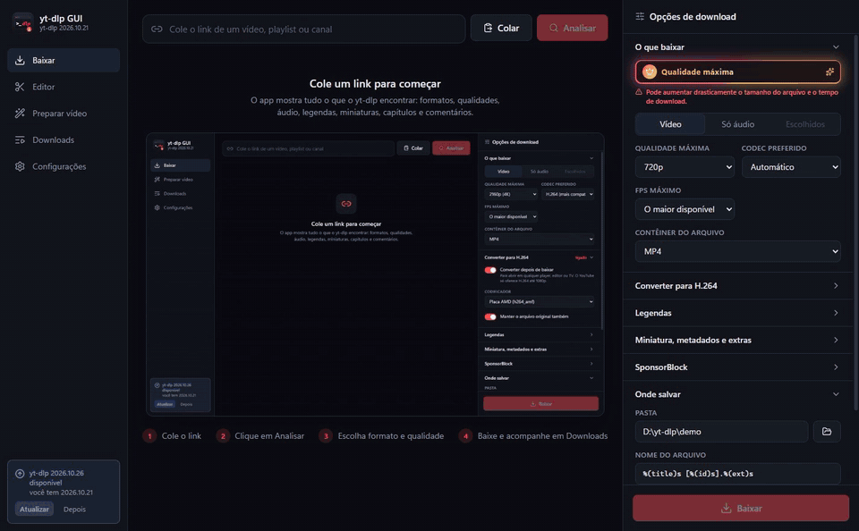

# yt-dlp GUI

Programa de desktop (Windows) que dá uma interface ao `yt-dlp`. Não altera nem copia o código do yt-dlp: roda o `yt-dlp.exe` por baixo, então atualizar o yt-dlp continua sendo só `yt-dlp -U` (ou o botão em Configurações).



**Baixar:** o instalador para Windows está em [Releases](https://github.com/ArthurDaviAraujo/ytdlp-studio/releases/latest).

Stack: Electron 45 + electron-vite + React 19 + TypeScript + Tailwind CSS 4.

## Rodar

```bash
npm install
npm run dev
```

Em desenvolvimento o app procura `yt-dlp.exe`, `ffmpeg.exe`, `ffprobe.exe` e as pastas do RIFE em `D:\yt-dlp\programas` (ou na pasta acima do projeto), depois no PATH. Os caminhos podem ser trocados em Configurações.

## Gerar o instalador

```bash
npm run dist
```

Sai em `release\yt-dlp GUI Setup <versão>.exe`. O instalador leva junto o `yt-dlp.exe`, o `ffmpeg.exe`, o `ffprobe.exe` e as pastas `rife` e `rife-comunidade` da pasta `D:\yt-dlp\programas`. Depois de gerado, ele pode ser movido para `D:\yt-dlp\instalador`. Na primeira execução eles são copiados para `%APPDATA%\yt-dlp GUI\bin`, onde o yt-dlp consegue se atualizar. O app instalado usa essa cópia; o modo de desenvolvimento usa sempre os programas de `D:\yt-dlp\programas`.

## O que tem

- **Análise do link** (`yt-dlp -J --flat-playlist`): todas as informações do vídeo, incluindo uma tabela com todos os campos e o JSON completo.
- **Formatos**: todos os formatos com resolução, FPS, HDR, codecs, bitrate, tamanho, idioma e protocolo. Dá para escolher 1 vídeo e 1 ou mais áudios (`--audio-multistreams`).
- **Modos rápidos**: vídeo com qualidade máxima e codec preferido (`-S`), só áudio (MP3, M4A, AAC, Opus, Vorbis, FLAC, ALAC, WAV) e contêiner MP4/MKV/WebM/MOV.
- **Legendas** enviadas e automáticas, com escolha de idioma, conversão (SRT/VTT/ASS/LRC) e opção de embutir.
- **Miniaturas** em todas as resoluções; salvar, converter ou embutir.
- **Capítulos e trechos**: baixar só alguns capítulos, um intervalo de tempo ou capítulos por regex (`--download-sections`); dividir por capítulo; SponsorBlock (marcar ou cortar).
- **Comentários**: carregados sob demanda, com respostas agrupadas.
- **Playlists e canais**: lista dos vídeos com seleção (`--playlist-items`) e detalhes de cada vídeo.
- **Todas as opções do yt-dlp**: lidas do `yt-dlp --help` da versão instalada (250 na 2026.10.21), com busca, valores e opções repetíveis, mais as predefinições `-t` e um campo de argumentos livres.
- **Fila de downloads**: progresso, velocidade, tempo restante, item da playlist, log, cancelar, tentar de novo, abrir o arquivo ou a pasta. Também tem histórico e uma prévia do comando.
- **Converter para H.264** depois de baixar, usando a GPU (AMD/NVIDIA/Intel) ou a CPU. Só aparecem os codificadores que funcionam na máquina.
- **FPS máximo** na hora de baixar (`-S fps:N`).
- **Preparar para postar**: um grupo no fim do painel de download e a página **Preparar vídeo**, que trabalha com qualquer vídeo do PC. Também aparece um botão "Preparar" em cada download concluído.
  - **Destinos prontos:** TikTok, Reels, Shorts, Instagram feed 4:5, Quadrado, YouTube e Personalizado. Você pode salvar predefinições suas.
  - **Tudo editável:** tamanho e proporção; enquadramento (cortar com posição, fundo desfocado com força, barras com cor); FPS; velocidade (0,25x a 4x, com o áudio acompanhando); trecho (início e fim); qualidade, codificador e limite de taxa de bits; áudio; e o final do nome do arquivo.
  - **Quadros novos**, quando o FPS final passa do original ou em câmera lenta:
    - Duplicar;
    - Placa AMD (`frc_amf`): dobra o FPS e o app compensa o atraso de 2 quadros do filtro;
    - Processador (`minterpolate`);
    - IA (RIFE): 47 modelos, modo UHD e TTA espacial e temporal. Os modelos v4 aceitam qualquer FPS; os outros só dobram.
  - O arquivo novo sai ao lado do original (`nome.tiktok.mp4`), sem apagar nada.

## Requisitos externos

- **Runtime JavaScript** para o YouTube: o yt-dlp procura o Deno sozinho. Se só houver Node, o app passa `--js-runtimes node:<caminho>`.
- **RIFE** em duas instalações, usadas juntas:
  - a oficial, [nihui/rife-ncnn-vulkan](https://github.com/nihui/rife-ncnn-vulkan) (MIT, 11 modelos), em `D:\yt-dlp\programas\rife`;
  - a da comunidade, [TNTwise/rife-ncnn-vulkan](https://github.com/TNTwise/rife-ncnn-vulkan) (MIT, versão 20250112), em `D:\yt-dlp\programas\rife-comunidade`. Dela só vieram os 36 modelos que a oficial não tem (v3.6 e v3.9, v4.1 a v4.26 e as variações lite, heavy e large).

  O app junta tudo numa lista só (47 modelos). Cada modelo roda com o programa da instalação de onde veio. Qualquer pasta `rife-*` ao lado da pasta `rife` vira mais uma instalação. Tudo roda pela Vulkan, então funciona em placas AMD, NVIDIA e Intel.
- **ffprobe.exe**: necessário para "embutir miniatura", para a página Preparar vídeo e para algumas correções. Ele precisa estar na mesma pasta do `ffmpeg.exe` que o app usa (o caminho aparece em Configurações), porque o yt-dlp só o procura ali.

## Estrutura

```
src/main/       processo principal: encontra os programas, roda o yt-dlp, fila, conversão
src/preload/    ponte segura entre a janela e o processo principal (window.api)
src/renderer/   interface em React
src/shared/     tipos usados pelos dois lados
```
