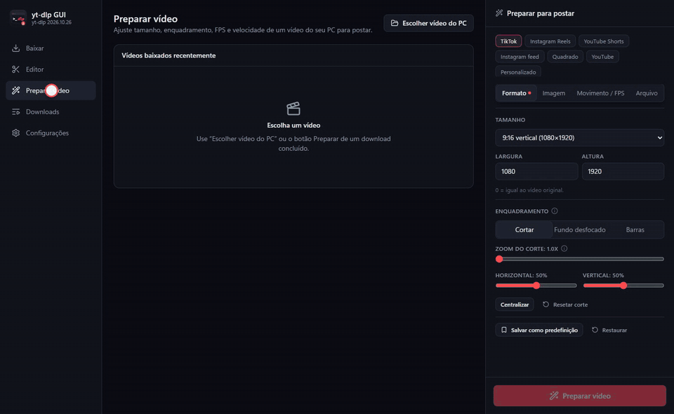

# yt-dlp GUI

Programa de desktop (Windows) que dá uma interface ao `yt-dlp`. Não altera nem copia o código do yt-dlp: roda o `yt-dlp.exe` por baixo, então atualizar o yt-dlp continua sendo só `yt-dlp -U` (ou o botão em Configurações).


**Baixar:** o instalador para Windows está em [Releases](https://github.com/ArthurDaviAraujo/ytdlp-studio/releases/latest).

**Android:** tem também um app de celular, na pasta [`mobile`](mobile/README.md). Ele baixa vídeos, recebe links pelo "Compartilhar" e prepara vídeos para as redes. A IA de quadros (RIFE) e a de imagem (Real-ESRGAN) são baixadas à parte, só por quem quiser. O APK sai na [release Android](https://github.com/ArthurDaviAraujo/ytdlp-studio/releases).

Stack: Electron 45 + electron-vite + React 19 + TypeScript + Tailwind CSS 4.

## Rodar

```bash
npm install
npm run dev
```

Em desenvolvimento o app procura `yt-dlp.exe`, `ffmpeg.exe`, `ffprobe.exe` e as pastas do RIFE em `D:\yt-dlp\programas` (ou na pasta acima do projeto), depois no PATH. Os caminhos podem ser trocados em Configurações.

## Gerar o instalador

```bash
npm run dist
```

Sai em `release\yt-dlp GUI Setup <versão>.exe`. O instalador leva junto o `yt-dlp.exe`, o `ffmpeg.exe`, o `ffprobe.exe` e o `deno.exe` da pasta `D:\yt-dlp\programas`.

As IAs não vão no instalador, e por isso ele tem cerca de 330 MB e não 1,1 GB. O app baixa cada uma só quando alguém vai usar, e também dá para baixar em Configurações → IAs e modelos. A lista fica em `src/shared/packs.ts`:

- RIFE, Real-ESRGAN, Real-CUGAN e o programa do Whisper vêm da release [`ia-pacotes`](https://github.com/ArthurDaviAraujo/ytdlp-studio/releases/tag/ia-pacotes) deste repositório. São arquivos .zip com a licença de cada projeto.
- Os modelos do Whisper vêm do Hugging Face.
- O modelo de separar voz vem do repositório de modelos do UVR.

Tudo é salvo em `%APPDATA%\yt-dlp GUI\bin`. Depois de gerado, ele pode ser movido para `D:\yt-dlp\instalador`. Na primeira execução eles são copiados para `%APPDATA%\yt-dlp GUI\bin`, onde o yt-dlp consegue se atualizar. O app instalado usa essa cópia; o modo de desenvolvimento usa sempre os programas de `D:\yt-dlp\programas`.

## O que tem

- **Análise do link** (`yt-dlp -J --flat-playlist`): todas as informações do vídeo, incluindo uma tabela com todos os campos e o JSON completo.
- **Formatos**: todos os formatos com resolução, FPS, HDR, codecs, bitrate, tamanho, idioma e protocolo. Dá para escolher 1 vídeo e 1 ou mais áudios (`--audio-multistreams`).
- **Modos rápidos**: vídeo com qualidade máxima e codec preferido (`-S`), só áudio (MP3, M4A, AAC, Opus, Vorbis, FLAC, ALAC, WAV) e contêiner MP4/MKV/WebM/MOV.
- **Legendas** enviadas e automáticas, com escolha de idioma, conversão (SRT/VTT/ASS/LRC) e opção de embutir.
- **Miniaturas** em todas as resoluções; salvar, converter ou embutir.
- **Capítulos e trechos**: baixar só alguns capítulos, um intervalo de tempo ou capítulos por regex (`--download-sections`); dividir por capítulo; SponsorBlock (marcar ou cortar).
- **Comentários**: carregados sob demanda, com respostas agrupadas.
- **Playlists e canais**: lista dos vídeos com seleção (`--playlist-items`) e detalhes de cada vídeo.
- **Todas as opções do yt-dlp**: lidas do `yt-dlp --help` da versão instalada (250 na 2026.10.21), com busca, valores e opções repetíveis, mais as predefinições `-t` e um campo de argumentos livres.
- **Idioma**: inglês (padrão) ou português, em Configurações. A troca vale na hora. Os textos ficam em `src/shared/i18n.ts` e `src/shared/i18n-en.ts`: a chave é o texto em português.
- **Fila de downloads**: progresso, velocidade, tempo restante, item da playlist, log, cancelar, tentar de novo, abrir o arquivo ou a pasta. Também tem histórico e uma prévia do comando.
- **Aviso do Windows** quando um download ou preparo termina com o app em segundo plano. Clicar no aviso abre a lista. Dá para desligar em Configurações.
- **Atualização do app**: o app consulta a última versão no GitHub ao abrir. Se houver uma nova, mostra um aviso no menu lateral, baixa o instalador com progresso e abre a instalação com um clique.
- **Converter para H.264** depois de baixar, usando a GPU (AMD/NVIDIA/Intel) ou a CPU. Só aparecem os codificadores que funcionam na máquina.
- **FPS máximo** na hora de baixar (`-S fps:N`).
- **Qualidade máxima**: um botão no painel de download e outro no Preparar vídeo, que deixam tudo no máximo com um clique e desligam voltando ao que estava antes. No download, o app pega o maior tamanho e FPS do site, o melhor áudio e não converte nada. No Preparar, usa imagem em 15, `libx264`, sem limite de taxa e áudio AAC 320 kbps. Um aviso lembra que o arquivo e o tempo podem crescer muito.
- **Preparar para postar**: um grupo no fim do painel de download e a página **Preparar vídeo**, que trabalha com qualquer vídeo do PC. Também aparece um botão "Preparar" em cada download concluído.
  - **Destinos prontos:** TikTok, Reels, Shorts, Instagram feed 4:5, Quadrado, YouTube e Personalizado. Você pode salvar predefinições suas.
  - **Tudo editável:** tamanho e proporção; enquadramento (cortar com posição, fundo desfocado com força, barras com cor); FPS; velocidade (0,1x a 16x, com o áudio acompanhando); trecho (início e fim); qualidade, codificador e limite de taxa de bits; áudio; e o final do nome do arquivo.
  - **Quadros novos**, quando o FPS final passa do original ou em câmera lenta:
    - Duplicar;
    - Placa AMD (`frc_amf`): dobra o FPS e o app compensa o atraso de 2 quadros do filtro;
    - Processador (`minterpolate`);
    - IA (RIFE): 47 modelos, modo UHD e TTA espacial e temporal. Os modelos v4 aceitam qualquer FPS; os outros só dobram.
  - **Melhorar imagem e som** (aba Imagem). Um ícone "i" explica cada opção técnica ao passar o mouse.

    

    - **Ampliar com IA**: [Real-ESRGAN](https://github.com/xinntao/Real-ESRGAN) (vídeo real, foto realista e anime) e [Real-CUGAN](https://github.com/nihui/realcugan-ncnn-vulkan) (anime). As duas rodam pela Vulkan, em pedaços, como o RIFE.
      - A escala é automática ou fixa em 2x, 3x ou 4x. Também dá para ajustar a limpeza da própria IA, a mistura com o original, o TTA, o tamanho do bloco e a placa de vídeo.
      - Funciona junto com o RIFE: primeiro amplia, depois cria os quadros.
      - Com "Manter o original", o resultado vai até 4K. Acima de 4096 px, o app grava com `libx264`, porque os codificadores das placas não passam disso.
    - **Limpeza**: ruído (`hqdn3d`, rápido, ou `nlmeans`, mais lento), quadradinhos da compressão (`deblock`), faixas em degradês (`deband`) e desentrelaçar (`bwdif`).
    - **Nitidez**: natural (`cas`) ou forte (`unsharp`).
    - **Cor e luz**: luz automática, brilho, contraste, sombras, saturação, vibração e temperatura.
    - **Correções**: estabilizar leve (`deshake`) ou forte (`vidstab`, em 2 passadas), tirar o pisca-pisca da luz e granulado de filme.
    - **Som** (aba Arquivo): cortar ronco e vento, tirar chiado (`afftdn`) e volume no padrão das redes (`loudnorm` a −14 LUFS, com opção de subir as partes baixas).
    - **7 receitas prontas**: Muito comprimido, Vídeo antigo/VHS, Celular no escuro, Anime/desenho, Só nitidez leve, Cores vivas e Voz limpa.
    - **Antes e depois**: um quadro do vídeo com uma divisória que se arrasta. Sem IA, a comparação se atualiza sozinha; com IA, só pelo botão (2 a 3 s por quadro).
    - **Resumo**: acima do botão Preparar, aparece o que vai sair (tamanho, IA, FPS, ajustes e tempo estimado).
  - O painel fica em abas (Formato, Imagem, Movimento / FPS e Arquivo). Uma aba com algo ligado ganha um ponto.
  - **Legendas automáticas** (aba Formato): o [Whisper](https://github.com/ggml-org/whisper.cpp) ouve a fala no seu PC e marca o tempo de cada palavra.
    - **Estilos:** TikTok (poucas palavras grandes, com a palavra falada em destaque, cor e quantidade escolhidas por você), frase (como no cinema) ou só o arquivo `.srt`.
    - **Opções:** três modelos (rápido, melhor e máximo), idioma automático ou escolhido, tradução para o inglês, posição, tamanho e maiúsculas.
    - **Legenda queimada:** vai no vídeo com o filtro `subtitles` (libass), já no tamanho final.
    - **Tempo certo desde o início:** o silêncio do começo é medido e descontado, para a primeira palavra não aparecer antes da hora.
  - **Seguir rosto ou pessoa** (aba Formato, enquadramento "Cortar"): o [MediaPipe](https://github.com/google-ai-edge/mediapipe) acha o rosto (ou a pessoa) em até 400 quadros do trecho.
    - O caminho é suavizado como o de uma câmera.
    - O corte do ffmpeg muda de posição 15 vezes por segundo (`sendcmd` + `crop`).
    - A prévia toca seguindo a pessoa, e o resultado funciona também com a IA de ampliar, com o RIFE e com as bordas pretas cortadas.
  - **Separar voz e música** (aba Arquivo → Som): o modelo Kim Vocal 2 (UVR MDX-Net) roda no ONNX Runtime, na placa de vídeo, pelo DirectML.
    - Dá para mudar o volume da voz e o da música e do fundo. Há atalhos para "Só a voz", "Sem voz (karaokê)", "Música mais baixa" e "Voz mais alta".
    - O STFT e o ISTFT (n_fft 7680, pelo algoritmo de Bluestein) são feitos em TypeScript.
    - Com legendas ligadas, o Whisper ouve só a voz separada.
  - **Texto e logo** por cima do vídeo (aba Formato):
    - **Texto:** posição, tamanho (diminui sozinho se não couber), cor e faixa escura ou contorno.
    - **Logo:** imagem PNG ou JPG, com posição, tamanho e opacidade.
  - **Cortar bordas pretas sozinho** (`cropdetect` em três pontos do vídeo).
  - **H.265 e AV1** pela placa (`hevc_amf`, `av1_amf`, NVIDIA e Intel) ou pelo processador (`libx265`). O arquivo fica de 20% a 50% menor com a mesma qualidade; o H.264 continua no "Automático".
  - **Preparar vários:** escolha vários vídeos e todos entram na fila com as mesmas opções.
  - **Estimar o tempo:** antes de exportar, o app faz a exportação de verdade em dois trechos curtos (1 s e 3 s). Assim ele separa o custo fixo do custo por segundo e calcula quanto o vídeo inteiro vai levar no seu PC. Também compara os métodos de quadros novos já medidos, para ver se vale a pena. A medição pode ser cancelada.
  - **Preparar depois de baixar**, no painel de download, faz tudo num pedido só: baixa e, em seguida, gera o arquivo preparado.
  - O arquivo novo sai ao lado do original (`nome.tiktok.mp4`), sem apagar nada.
- **Editor** (aba própria; também pelo botão "Editar" de cada download):
  - **Linha do tempo** com miniaturas, onda do áudio, régua e zoom. "Cortar aqui" (S) divide o vídeo, "Apagar trecho" (Delete) tira a parte, e as divisas se arrastam para ajustar. A prévia já pula os trechos apagados.
  - **Músicas de fundo**: quantas quiser, cada uma numa trilha. Arrastando o clipe, você escolhe onde ela começa no vídeo. Arrastando as pontas, corta o começo ou o fim. "Na agulha" põe a música onde está a agulha. Também há volume, repetir e suavizar.
  - **Mixer** numa janela própria, que fica por cima do app e vai para qualquer lugar da tela: ganho, agudo, médio, grave e volume de cada som (vídeo e cada música), com medidores. A prévia usa o Web Audio (`BiquadFilterNode`) e o arquivo final usa os filtros `bass`/`equalizer`/`treble` do ffmpeg, com as mesmas fórmulas.
  - **Velocidade** livre (0,1x a 16x); as músicas continuam na velocidade normal.
  - **Ctrl+Z / Ctrl+Y** desfazem e refazem tudo: cortes, músicas, volumes, equalizador e velocidade.
  - **Preparar para postar** leva os cortes e as músicas para a página Preparar vídeo sem exportar antes; o arquivo final sai numa exportação só. "Exportar só o vídeo editado" gera `nome.edited.mp4`.

## Requisitos externos

- **Runtime JavaScript** para o YouTube: o yt-dlp procura o Deno sozinho. Se só houver Node, o app passa `--js-runtimes node:<caminho>`.
- **RIFE** em duas instalações, usadas juntas:
  - a oficial, [nihui/rife-ncnn-vulkan](https://github.com/nihui/rife-ncnn-vulkan) (MIT, 11 modelos), em `D:\yt-dlp\programas\rife`;
  - a da comunidade, [TNTwise/rife-ncnn-vulkan](https://github.com/TNTwise/rife-ncnn-vulkan) (MIT, versão 20250112), em `D:\yt-dlp\programas\rife-comunidade`. Dela só vieram os 36 modelos que a oficial não tem (v3.6 e v3.9, v4.1 a v4.26 e as variações lite, heavy e large).

  O app junta tudo numa lista só (47 modelos). Cada modelo roda com o programa da instalação de onde veio. Qualquer pasta `rife-*` ao lado da pasta `rife` vira mais uma instalação. Tudo roda pela Vulkan, então funciona em placas AMD, NVIDIA e Intel.
- **Ampliar com IA**, também pela Vulkan:
  - [Real-ESRGAN ncnn-vulkan](https://github.com/xinntao/Real-ESRGAN) 20220424 (BSD-3-Clause), em `D:\yt-dlp\programas\realesrgan`, com os modelos `realesr-animevideov3` (2x, 3x e 4x), `realesrgan-x4plus` e `realesrgan-x4plus-anime`;
  - [Real-CUGAN ncnn-vulkan](https://github.com/nihui/realcugan-ncnn-vulkan) 20220728 (MIT), em `D:\yt-dlp\programas\realcugan`, com os modelos `se`, `pro` e `nose`.
- **Legendas**: [whisper.cpp](https://github.com/ggml-org/whisper.cpp) b5454 (MIT), em `D:\yt-dlp\programas\whisper`, com os modelos em `whisper\models`. São eles `ggml-base.bin`, `ggml-small.bin` e `ggml-large-v3-turbo-q5_0.bin`.
- **Seguir rosto ou pessoa**: `@mediapipe/tasks-vision` 1.2.2 (Apache-2.0). O WASM e os modelos `blaze_face_short_range` e `efficientdet_lite0` ficam em `src/renderer/public/mediapipe`.
- **Separar voz e música**: `onnxruntime-node` 1.31.1 (MIT, com DirectML) e o modelo `Kim_Vocal_2.onnx` (UVR), em `D:\yt-dlp\programas\separar`. No instalador vai só o binário do Windows x64 do ONNX Runtime, fora do asar.
- **ffprobe.exe**: necessário para "embutir miniatura", para a página Preparar vídeo e para algumas correções. Ele precisa estar na mesma pasta do `ffmpeg.exe` que o app usa (o caminho aparece em Configurações), porque o yt-dlp só o procura ali.

## Estrutura

```
src/main/       processo principal: encontra os programas, roda o yt-dlp, fila, conversão
src/preload/    ponte segura entre a janela e o processo principal (window.api)
src/renderer/   interface em React
src/shared/     tipos usados pelos dois lados (e pelo app de celular)
mobile/         app Android (Capacitor + Kotlin + motor de IA em C++)
```
